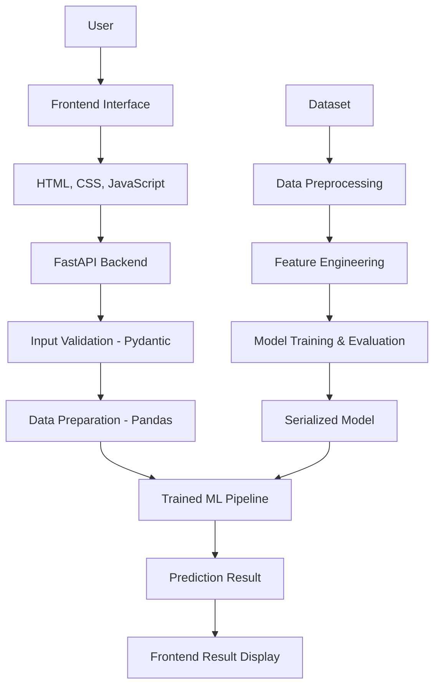

<div align="center">

# Student Mental Health Score Predictor

### A Machine Learning Based Web Application for Predicting Student Mental Health Scores

An end-to-end Machine Learning project that estimates students' mental health scores based on their social media usage, academic habits, lifestyle choices, and stress levels.

<br>


</div>

---

## Overview

Student mental health is influenced by several interconnected factors, including social media consumption, sleep patterns, academic pressure, physical activity, and daily lifestyle habits.

The **Student Mental Health Score Predictor** is a full-stack Machine Learning application designed to explore these relationships and estimate a student's mental health score on a scale of 1 to 10.

The application combines a trained Machine Learning model with a FastAPI backend and an interactive frontend to provide predictions through a simple web interface.

> **Disclaimer:** This application provides statistical estimates for educational purposes only. It is not a clinical assessment, medical diagnosis, or substitute for professional mental health support.

## Key Features

- **Mental Health Score Prediction:** Estimates a student's mental health score on a scale of 1–10.
- **Machine Learning Integration:** Uses a trained Scikit-learn pipeline for predictions.
- **Interactive Web Interface:** Collects user information through a responsive interface.
- **Lifestyle Analysis:** Considers sleep, physical activity, study hours, stress, and social media habits.
- **REST API:** Uses FastAPI to handle prediction requests.
- **Input Validation:** Validates incoming data using Pydantic.
- **Real-time Results:** Displays prediction results through the frontend.
- **Model Persistence:** Loads a previously trained model for predictions.

## Technology Stack

| Component | Technologies |
|---|---|
| Programming Language | Python |
| Frontend | HTML, CSS, JavaScript |
| Backend | FastAPI, Uvicorn |
| Machine Learning | Scikit-learn |
| Data Processing | Pandas, NumPy |
| Model Persistence | Joblib |
| Development Environment | Jupyter Notebook |
| API Communication | REST API, JSON |

## Project Architecture

The application follows a simple full-stack Machine Learning architecture.



### How It Works

1. The user enters demographic, academic, social media, and lifestyle information through the web interface.
2. JavaScript collects the form inputs and sends them as a JSON request.
3. FastAPI receives the request through the `/predict` endpoint.
4. Pydantic validates the incoming data.
5. Pandas prepares the input data for the trained Machine Learning pipeline.
6. The serialized model generates a predicted mental health score.
7. The backend returns the prediction as a JSON response.
8. The frontend displays the predicted score.

## Input Features

The model considers the following input variables:

| Feature | Description |
|---|---|
| Age | Student's age |
| Gender | Student's gender |
| Country | Country of residence |
| Academic Level | High School, Undergraduate, or Graduate |
| Most Used Platform | Primary social media platform |
| Purpose of Use | Entertainment, Education, Networking, or News |
| Daily Usage | Average daily social media usage in hours |
| Daily Unlocks | Number of phone unlocks per day |
| Study Hours | Average daily study hours |
| Physical Activity | Daily physical activity in hours |
| Sleep Hours | Average sleep duration per night |
| Stress Level | Low, Medium, High, or Very High |

## Machine Learning Workflow

The Machine Learning development process is documented in `ML_Project.ipynb`.

The workflow includes:

**1. Data Collection and Exploration**
- Loading the student social media and mental health dataset.
- Understanding the dataset structure.
- Exploring feature distributions and relationships.

**2. Data Preprocessing**
- Handling missing values.
- Preparing numerical and categorical features.
- Encoding categorical variables.
- Scaling numerical features.

**3. Model Development**
- Comparing different regression approaches.
- Developing a Random Forest regression pipeline.
- Tuning model hyperparameters.

**4. Model Evaluation**

The following evaluation metrics are used:

- R-squared (R²)
- Mean Absolute Error (MAE)
- Root Mean Squared Error (RMSE)

**5. Model Deployment**

The trained pipeline is serialized using Joblib and saved as:

`Mental_Health_Model.pkl`

The FastAPI backend loads this model to generate predictions.

## Project Structure

```text
Mental_Health_Score_Predictor/
│
├── index.html
│   └── Frontend web interface
│
├── style.css
│   └── Frontend styling
│
├── script.js
│   └── API communication and result handling
│
├── main.py
│   └── FastAPI backend and prediction endpoint
│
├── Mental_Health_Model.pkl
│   └── Trained Machine Learning pipeline
│
├── ML_Project.ipynb
│   └── Data analysis and model training
│
├── ML Project.html
│   └── Exported Jupyter Notebook report
│
├── Student Social Media And Mental Health Impact.csv
│   └── Dataset
│
├── requirements.txt
│   └── Python dependencies
│
└── README.md
    └── Project documentation
```

## Getting Started

Follow these instructions to run the project locally.

### Prerequisites

Make sure you have installed:

- Python 3.10 or later
- pip
- Git
- A modern web browser

### 1. Clone the Repository

```bash
git clone https://github.com/ankitroy531800869/Mental_Health_Score_Predictor.git
```

Navigate into the project directory:

```bash
cd Mental_Health_Score_Predictor
```

### 2. Create a Virtual Environment

```bash
python -m venv .venv
```

Activate the environment on Windows PowerShell:

```powershell
.venv\Scripts\Activate.ps1
```

### 3. Install Dependencies

```bash
python -m pip install --upgrade pip
pip install -r requirements.txt
```

### 4. Start the FastAPI Backend

```bash
uvicorn main:app --host 127.0.0.1 --port 2200 --reload
```

The API will be available at:

`http://127.0.0.1:2200`

### 5. Launch the Frontend

Open another terminal in the project directory and execute:

```bash
python -m http.server 5500
```

Open the following address in your browser:

`http://127.0.0.1:5500/index.html`

**Important:** Keep both the frontend server and FastAPI backend running while using the application.

## API Documentation

The backend exposes an interactive API documentation interface through FastAPI.

| Documentation | URL |
|---|---|
| Swagger UI | http://127.0.0.1:2200/docs |
| ReDoc | http://127.0.0.1:2200/redoc |

### Prediction Endpoint

**Endpoint:** `POST /predict`

**Example Request:**

```json
{
  "age": 20,
  "gender": "Female",
  "country": "India",
  "academic_level": "Undergraduate",
  "most_used_platform": "Instagram",
  "purpose_of_use": "Entertainment",
  "avg_daily_usage_hours": 4.5,
  "daily_unlocks": 60,
  "study_hours": 4,
  "physical_activity_hours": 1,
  "sleep_hours_per_night": 7,
  "stress_level": "Medium"
}
```

**Example Response:**

```json
{
  "predicted_mental_health_score": 7.42
}
```

*The response above is an illustrative example.*

## Future Improvements

Potential improvements for future versions include:

- Model performance optimization and further hyperparameter tuning.
- Additional Machine Learning model comparisons.
- Interactive visualizations of lifestyle and mental health trends.
- Improved prediction explainability using SHAP.
- User authentication and personalized dashboards.
- Deployment using cloud infrastructure.
- More comprehensive model evaluation and validation.

## Author

**Ankit Roy**

Computer Science & Engineering Student

[](https://github.com/ankitroy531800869)

---

<div align="center">

**If you find this project interesting, consider giving it a star!**

Made using Python and Machine Learning.

</div>
